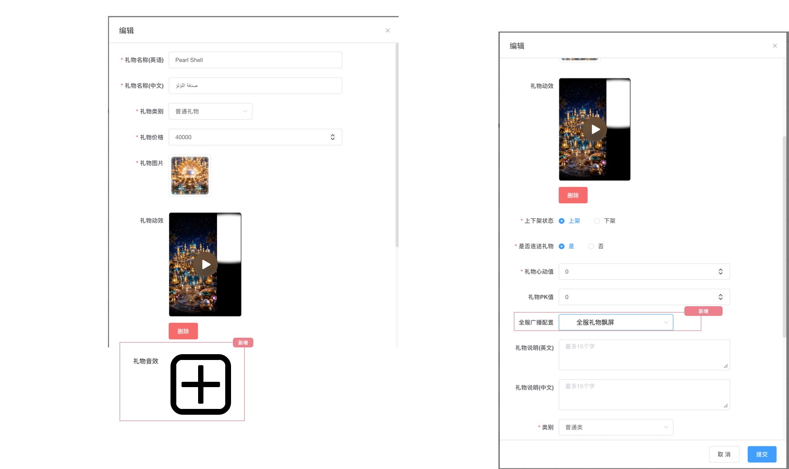
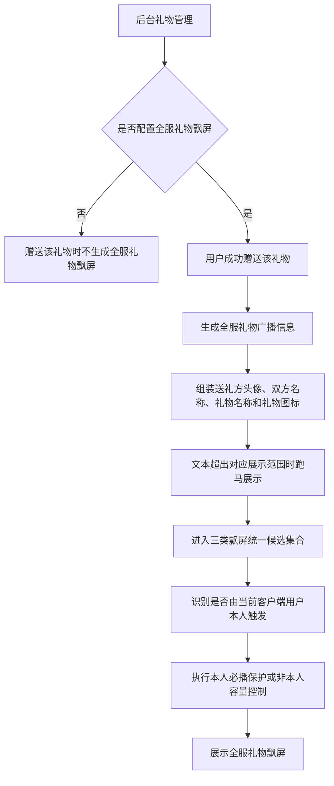
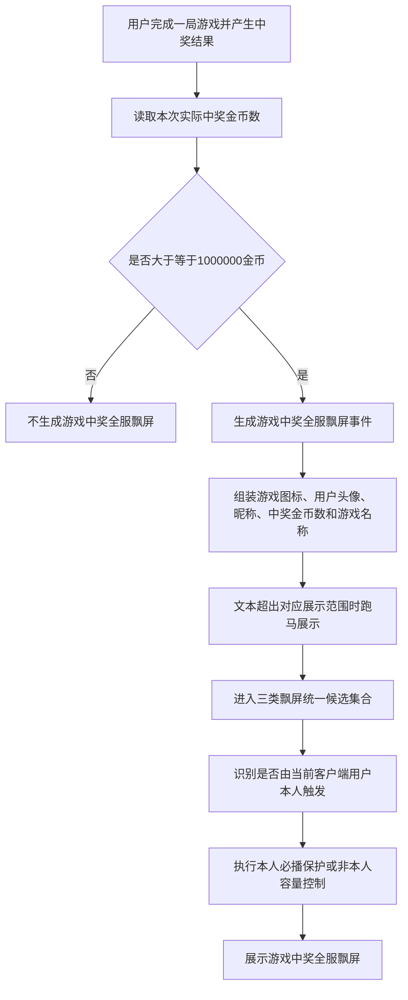
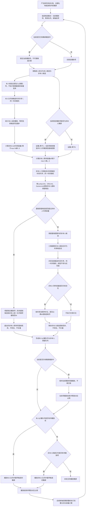

# TOPKHALIJ 2.1.36 需求文档

| 项目 | 内容 |
|---|---|
| 产品 | TOPKHALIJ |
| 版本 | 2.1.36 |
| 文档状态 | 游戏、礼物飘屏独立版本范围 |
| 拆分来源 | 从上一版本综合需求文档拆分游戏、礼物飘屏相关需求 |
| 原型来源 | `2.1.36原型图/` 下 3 张 JPG |

## 一、版本目标与范围

本版本独立承接全服礼物飘屏、游戏中奖全服飘屏，以及幸运礼物飘屏、全服礼物飘屏、游戏中奖全服飘屏三类飘屏共用的队列、容量和播放规则。

| 端 | 本次模块 |
|---|---|
| 客户端 | 全服礼物飘屏展示、游戏中奖全服飘屏展示、三类飘屏统一队列与容量控制 |
| 后台 | 礼物管理中的“全服礼物飘屏”广播配置 |
| 既有能力接入 | 幸运礼物飘屏接入统一队列与容量控制；本版本不调整其既有触发条件和展示内容 |

### 1.1 本次包含范围

1. 配置礼物触发全服礼物飘屏。
2. 游戏中奖金币数达到阈值后触发游戏中奖全服飘屏。
3. 全服礼物、幸运礼物、游戏中奖三类飘屏统一进入双队列。
4. 当前客户端用户自己触发的所有飘屏全部保留、全部播放，并整体优先于其他用户触发的飘屏。
5. 其他用户触发的三类飘屏在扣除本人飘屏占用后的剩余容量内，继续按基础配额与共享容量补位逻辑处理。
6. 本人飘屏可在必要时突破房间常规容量 `N`；其他用户飘屏超限丢弃，当前播放项不可打断，名额释放后对新触发项实时重新判定。

### 1.2 本次不包含范围

- 不调整幸运礼物飘屏既有触发条件、展示字段和视觉样式。
- 不调整普通房间消息、系统通知及其他非本版本飘屏的排序规则。
- 不调整礼物本身的价格、赠送对象、数量选择、扣费和到账逻辑。
- 不调整游戏中奖结果的计算方式；本版本只读取实际中奖金币数判断是否触发飘屏。
- 不包含用户身份、首页、靓号搜索、房间黑名单和第三方充值 H5 等上一版本其他模块。

### 1.3 源材料采用原则

1. 原型用于确认页面结构、字段位置和展示形态；已确认的补充规则用于定义触发、队列和容量逻辑。
2. 原型中的用户名、游戏名、礼物名和金币数均为展示样例，不作为固定配置值。
3. 幸运礼物飘屏在本版本中仅作为统一队列的一种既有飘屏类型，不据此补造其触发与展示规则。

---

## 二、核心业务规则

### 2.1 飘屏类型

| 飘屏类型 | 本版本处理 |
|---|---|
| 幸运礼物飘屏 | 沿用既有触发与展示规则；本人触发项全部播放，非本人触发项接入基础配额和共享容量控制。 |
| 全服礼物飘屏 | 新增后台广播配置；命中配置的礼物被赠送时，在所有房间展示。 |
| 游戏中奖全服飘屏 | 用户单次游戏实际中奖金币数大于等于 `1,000,000` 时，在全服展示。 |

### 2.2 统一播放顺序

三类飘屏不按类型设置固定播放优先级，统一分为本人必播队列与非本人容量控制队列。

| 队列分层 | 进入条件 | 播放顺序 |
|---|---|---|
| 本人必播队列 | 当前客户端用户自己触发幸运礼物、全服礼物或游戏中奖飘屏。 | 所有飘屏全部保留、全部播放，不受基础配额和容量丢弃规则限制；整体优先于非本人队列，队列内按触发时间升序播放。 |
| 非本人容量控制队列 | 非当前客户端用户触发幸运礼物、全服礼物或游戏中奖飘屏。 | 在房间剩余容量内按现有基础配额与共享容量规则保留；本人队列为空后播放，队列内按触发时间升序播放。 |

- 同一触发时间的飘屏随机排序。
- 飘屏类型不参与队列播放优先级排序。
- 当前正在播放的飘屏不可被任何新飘屏替换或打断；新飘屏只能进入候选集合并等待后续播放。
- 当前正在播放的是非本人飘屏时，即使新产生本人飘屏，也必须先让当前飘屏完整播放；播放结束后再优先播放本人必播队列。

### 2.3 房间容量与基础配额

| 服务端房间级配置 | 适用范围 | 默认值与规则 |
|---|---|---|
| 房间常规飘屏容量 `N` | 本人及非本人飘屏合计的常规容量 | 暂定 `30` 条。本人飘屏数量不超过 `N` 时，非本人飘屏只能使用扣除本人占用后的剩余容量；本人飘屏单独超过 `N` 时允许队列临时突破 `N`。 |
| 幸运礼物基础配额 `LuckyLimit` | 非本人幸运礼物飘屏 | 默认 `10` 条；属于非本人候选第一轮基础保留配额，不是该类型硬上限。 |
| 全服礼物基础配额 `GiftLimit` | 非本人全服礼物飘屏 | 默认 `10` 条；属于非本人候选第一轮基础保留配额，不是该类型硬上限。 |
| 游戏中奖基础配额 `GameLimit` | 非本人游戏中奖全服飘屏 | 默认 `10` 条；属于非本人候选第一轮基础保留配额，不是该类型硬上限。 |

#### 2.3.1 候选集合

每次触发新飘屏时，以以下内容组成当前候选集合：

1. 当前正在播放的飘屏；
2. 当前等待队列中的飘屏；
3. 本次新触发的飘屏。

当前正在播放项保持锁定，不参与替换或打断。本人正在播放项计入本人必播数量；非本人正在播放项占用其所属类型的基础配额及 1 个非本人容量名额。

#### 2.3.2 本人必播保留与非本人可用容量

1. 先从候选集合中识别当前客户端用户自己触发的飘屏，全部加入本人必播队列，不执行基础配额截取，也不得因容量不足被丢弃。
2. 设本人当前播放项、本人等待项及本次本人新触发项总数为 `P`。
3. 非本人飘屏总可用容量为：`C = max(N - P, 0)`。
4. 当前正在播放的是非本人飘屏时，设锁定占用 `L = 1`；该项即使在 `C = 0` 时也继续播放，不得中断。当前没有非本人飘屏播放时，`L = 0`。
5. 非本人等待队列可用容量为：`W = max(C - L, 0)`。
6. 当 `P > N` 时，本人必播队列允许临时超过 `N`，此时 `C = 0`、`W = 0`，除已锁定播放项外不再保留任何非本人等待项。

#### 2.3.3 非本人基础配额与共享容量补位

1. 仅对非本人候选执行本节规则；本人飘屏不参与以下基础配额和共享容量竞争。
2. 非本人三类飘屏分别按触发时间升序排序；同一触发时间随机。
3. 幸运礼物最多先取 `LuckyLimit` 条、全服礼物最多先取 `GiftLimit` 条、游戏中奖最多先取 `GameLimit` 条，组成非本人基础保留候选。已锁定播放的非本人飘屏计入其所属类型基础配额。
4. 若非本人基础保留候选总数大于 `C`，将基础保留候选按非本人统一队列规则排序；锁定播放项保留，其余只截取到 `W`，超出项直接丢弃。
5. 若基础保留候选未占满 `C`，将三类未进入基础配额的非本人超额候选合并为共享候选池。
6. 共享候选池按触发时间升序、同一时间随机排序，不按飘屏类型设置补位优先级。
7. 按共享候选池顺序补入剩余的非本人等待容量，直至非本人总数达到 `C` 或共享候选池为空。
8. 某类型候选数不足其基础配额时，未使用容量自动转为非本人共享空闲容量，不为该类型保留空位。

#### 2.3.4 保护、淘汰、释放与重新判定

- 本人触发的所有飘屏均为必播项，任何情况下不得因 `N`、基础配额或共享容量不足被丢弃。
- 本人新飘屏进入候选集合后，若常规容量不足，先压缩或淘汰非本人等待项，为本人必播项让出容量。
- 当前正在播放的非本人飘屏属于锁定项，不因本人新飘屏到达而中断；由此产生的临时超出容量允许持续至该项播放结束。
- 本人飘屏数量单独超过 `N` 时，允许本人队列临时超过 `N`，并按本人队列触发时间顺序全部播放。
- 只有非本人等待候选会执行超限丢弃；被丢弃项不进入隐藏等待队列，也不因后续名额释放而补播。
- 任一本人飘屏播放结束后，释放 1 个本人占用；任一非本人飘屏播放结束后，释放其类型基础配额占用和 1 个非本人容量名额。
- 后续产生新飘屏时，重新执行“本人必播保留 → 计算非本人可用容量 → 非本人基础配额保留 → 非本人共享容量补位”，无需等待整个队列播放完毕。

### 2.4 容量分配 EG

| 场景 | 容量计算 | 非本人现有逻辑 | 最终结果 |
|---|---|---|---|
| 本人 8 条、非本人 40 条 | `P = 8`，非本人总可用容量 `C = 22` | 40 条非本人飘屏在 22 个名额内执行基础配额与共享补位 | 本人 8 条全部保留；非本人最多保留 22 条，合计不超过 30 条。 |
| 本人 35 条、非本人 20 条，当前无飘屏播放 | `P = 35`，`C = 0` | 非本人无可用容量，20 条均按超限丢弃 | 本人 35 条全部保留并播放，队列允许临时超过 `N = 30`。 |
| 本人 35 条，当前正播放 1 条非本人飘屏，另有 19 条非本人等待 | `P = 35`，`C = 0`，锁定项 `L = 1`，`W = 0` | 当前非本人播放项不可中断；19 条非本人等待项全部丢弃 | 当前时刻可临时存在 35 条本人飘屏加 1 条锁定播放项；锁定项结束后只剩本人必播队列。 |
| 原有 30 条均为非本人，其中 1 条正在播放；此时新增 5 条本人飘屏 | `P = 5`，`C = 25`，`L = 1`，`W = 24` | 锁定播放项继续；原 29 条非本人等待项只保留 24 条，淘汰 5 条 | 5 条本人飘屏全部保留，当前播放项结束后优先播放本人队列。 |
| 本人 8 条，非本人游戏 20 条、全服礼物 20 条 | `P = 8`，`C = 22` | 非本人游戏和全服礼物各先保留 10 条，再从共享池按时间顺序补 2 条 | 本人 8 条全部保留；非本人保留 22 条，合计 30 条。 |
| 本人 8 条，非本人三类各 20 条 | `P = 8`，`C = 22` | 三类基础候选合计 30 条，超过 `C`；按非本人统一队列顺序截取 22 条 | 本人 8 条全部保留；非本人类型不参与最终截取优先级。 |
| 非本人队列已满可用容量，随后 1 条播放完成 | 播放结束后释放 1 个非本人容量名额 | 旧的已丢弃项不复活；下一条新触发的非本人飘屏重新执行容量判断 | 新触发项有资格时可以进入，旧丢弃项仍不补播。 |

---

## 三、客户端需求

### 3.1 全服礼物飘屏

#### 对应原型

#### 3.1.1 触发条件与范围

后台为礼物配置“全服礼物飘屏”广播选项后，用户赠送该礼物时，所有房间接收该礼物广播并展示全服礼物飘屏。

| 条件 | 处理 |
|---|---|
| 礼物已配置“全服礼物飘屏” | 赠送成功后生成全服礼物飘屏，并进入统一队列。 |
| 礼物未配置“全服礼物飘屏” | 不触发本版本全服礼物飘屏。 |

#### 3.1.2 展示结构

| 展示区块 | 展示内容 | 超长处理 |
|---|---|---|
| 用户头像 | 送礼方头像。 | 不跑马。 |
| 用户信息 | 送礼方名称、收礼方名称。 | 文本超出对应展示范围时跑马展示；存在多个收礼方时使用英文逗号 `,` 分隔。 |
| 礼物信息 | 礼物名称、礼物图标。 | 礼物名称超出对应展示范围时跑马展示；礼物图标不跑马。 |
| 文案结构 | “送礼方给收礼方赠送了礼物名称”。 | 使用实际用户和礼物数据替换原型占位内容；超出对应展示范围时跑马展示。 |

#### 3.1.3 队列与容量

- 全服礼物飘屏统一接入 §2.2～§2.3 的双队列和容量分配规则。
- 当前用户自己触发的全服礼物飘屏全部进入本人必播队列，不受 `GiftLimit` 和 `N` 的丢弃限制。
- 其他用户触发的全服礼物飘屏进入非本人容量控制队列；`GiftLimit` 默认 10 条，仅为非本人候选第一轮基础配额，超额项仍可进入共享候选池。

### 3.2 游戏中奖全服飘屏

#### 对应原型

#### 3.2.1 触发条件与范围

| 规则 | 说明 |
|---|---|
| 触发条件 | 用户单次游戏实际中奖金币数大于等于 `1,000,000` 金币时，生成游戏中奖全服飘屏。 |
| 展示范围 | 满足触发条件的中奖信息在全服展示。 |
| 非触发情况 | 实际中奖金币数小于 `1,000,000` 金币时，不生成游戏中奖全服飘屏。 |
| 数据口径 | 读取游戏最终产生的实际中奖金币数；本版本不改变游戏中奖计算规则。 |

#### 3.2.2 展示位置与结构

飘屏位于游戏画面顶部、系统状态栏下方，覆盖在游戏场景之上；整体为横向信息条，左侧展示用户信息，右侧展示游戏图标。

| 展示区块 | 展示内容 | 超长处理 |
|---|---|---|
| 用户头像 | 中奖用户头像。 | 不跑马。 |
| 用户昵称 | 中奖用户昵称。 | 超出对应展示范围时跑马展示。 |
| 中奖文案 | 用户在对应游戏中中奖的金币数。 | 超出对应展示范围时跑马展示。 |
| 游戏名称 | 中奖游戏名称。 | 超出对应展示范围时跑马展示。 |
| 游戏图标 | 对应游戏图标。 | 不跑马。 |

文案需表达“用户在游戏名称中获得中奖金币数金币”的中奖事实。原型中的用户名、游戏名和金币数仅为占位示例。

#### 3.2.3 队列与容量

- 游戏中奖全服飘屏统一接入 §2.2～§2.3 的双队列和容量分配规则，不因类型获得独立播放优先级。
- 当前用户自己中奖触发的飘屏全部进入本人必播队列，不受 `GameLimit` 和 `N` 的丢弃限制。
- 其他用户中奖触发的飘屏进入非本人容量控制队列；`GameLimit` 默认 10 条，仅为非本人候选第一轮基础配额，超额项仍可进入共享候选池。

### 3.3 幸运礼物飘屏接入规则

- 幸运礼物飘屏沿用既有触发条件、展示字段和视觉样式。
- 幸运礼物飘屏统一接入 §2.2～§2.3 的双队列和容量分配规则。
- 当前用户自己触发的幸运礼物飘屏全部进入本人必播队列，不受 `LuckyLimit` 和 `N` 的丢弃限制。
- 其他用户触发的幸运礼物飘屏进入非本人容量控制队列；`LuckyLimit` 默认 10 条，仅为非本人候选第一轮基础配额，超额项仍可进入共享候选池。
- 幸运礼物飘屏不因类型获得独立播放优先级。

---

## 四、后台需求

### 4.1 礼物管理：全服礼物飘屏配置

#### 对应原型

#### 4.1.1 配置规则

| 配置状态 | 规则 |
|---|---|
| 配置“全服礼物飘屏” | 用户赠送该礼物成功后，所有房间接收广播信息并生成全服礼物飘屏。 |
| 未配置“全服礼物飘屏” | 该礼物不触发本版本全服礼物飘屏。 |

- 本版本只新增或使用“全服礼物飘屏”配置，不改写原型未展开的其他全服广播选项。
- 该配置只决定是否生成全服礼物飘屏；生成后的排序、容量和播放处理统一遵循 §2.2～§2.3。

### 4.2 房间级飘屏数量配置

服务端按房间读取以下数量配置：

| 配置 | 默认值 | 配置含义 |
|---|---:|---|
| `N` | 30 | 房间常规飘屏容量；本人飘屏单独超过该值时允许临时突破。 |
| `LuckyLimit` | 10 | 非本人幸运礼物第一轮基础配额。 |
| `GiftLimit` | 10 | 非本人全服礼物第一轮基础配额。 |
| `GameLimit` | 10 | 非本人游戏中奖第一轮基础配额。 |

本人飘屏全部保留、全部播放，不参与基础配额截取。非本人飘屏只能使用 `max(N - 本人飘屏数量, 0)` 的剩余容量；三类基础配额不是各类型硬上限，非本人候选超过基础配额后可继续进入共享候选池。若本人飘屏单独超过 `N`，允许房间队列临时超过 `N`，但不再保留非本人等待项；当前正在播放的非本人飘屏仍需完整播放。

---

## 五、业务流程

### 5.1 全服礼物飘屏触发链路

### 5.2 游戏中奖全服飘屏触发链路

### 5.3 统一容量分配与播放链路

---

## 六、异常与边界

| 场景 | 处理规则 |
|---|---|
| 游戏实际中奖金币数小于阈值 | 不生成游戏中奖全服飘屏。 |
| 礼物未配置全服礼物飘屏 | 不生成本版本全服礼物飘屏。 |
| 当前已有飘屏正在播放 | 当前播放项完整播放；任何新飘屏均不得打断。 |
| 本人飘屏数量未超过 `N` | 非本人飘屏只使用 `N - 本人飘屏数量` 的剩余容量。 |
| 本人飘屏数量超过 `N` | 本人飘屏全部保留并播放，队列允许临时超过 `N`；非本人等待容量为 0。 |
| 本人新飘屏到达时非本人等待项已占满容量 | 当前播放项保持不动；按非本人统一队列规则压缩等待项，为本人必播项让出容量。 |
| 本人新飘屏到达时正在播放非本人飘屏 | 该非本人飘屏继续完整播放；本人飘屏全部进入必播队列，待当前项结束后优先播放。 |
| 非本人三类基础配额合计未达到可用容量 | 未使用容量转为非本人共享空闲容量，允许其他非本人类型的超额候选借用。 |
| 非本人三类基础候选合计超过可用容量 | 锁定播放项保持不动，其余基础候选按非本人统一队列顺序截取至可用容量。 |
| 非本人候选超过最终可用容量 | 超出部分直接丢弃，不进入隐藏等待队列。 |
| 非本人历史飘屏已被容量规则丢弃 | 后续名额释放时不补播。 |
| 播放结束后产生新飘屏 | 新飘屏重新执行本人必播保留、非本人容量计算、基础配额和共享补位，不需要等待原队列全部播放完。 |
| 横幅文本过长 | 全服礼物和游戏中奖横幅中的文本在各自展示区域内跑马；头像和图标不跑马。 |
| 本人及非本人保留候选合计小于 `N` | 按实际候选数展示，剩余容量允许空置。 |

---

## 七、源材料覆盖核对

| 需求模块 | PRD章节 | 原型文件 | 覆盖结论 |
|---|---|---|---|
| 全服礼物飘屏展示 | 3.1、5.1 | `房间全服礼物飘屏.jpg` | 已覆盖触发范围、送礼方头像、双方名称、礼物信息和文本跑马。 |
| 游戏中奖全服飘屏 | 3.2、5.2 | `游戏中奖全服飘屏.jpg` | 已覆盖阈值、展示位置、用户及游戏字段、文本跑马。 |
| 后台礼物广播配置 | 4.1、5.1 | `礼物管理.jpg` | 已覆盖配置与未配置两种状态。 |
| 三类飘屏统一队列与容量 | 2.2～2.4、4.2、5.3、6 | 无独立原型；来源为已确认补充规则 | 已覆盖本人全部必播、本人可突破 `N`、非本人剩余容量、基础配额、共享补位、当前播放不可打断、非本人丢弃和实时重新判定。 |
| 幸运礼物飘屏接入 | 2.1～2.3、3.3、5.3 | 无新增原型 | 仅接入统一队列与容量；既有触发及展示保持不变。 |

## 八、已确认规则汇总

| 模块 | 已确认规则 |
|---|---|
| 游戏中奖触发阈值 | 实际中奖金币数大于等于 `1,000,000` 金币。 |
| 类型播放优先级 | 三类飘屏之间不设置类型优先级。 |
| 本人必播 | 当前客户端用户自己触发的所有飘屏全部保留、全部播放，不受基础配额和容量丢弃规则限制。 |
| 用户队列优先级 | 本人必播队列整体优先于非本人容量控制队列，但不得打断当前正在播放的飘屏。 |
| 队列内部排序 | 按触发时间升序；同一触发时间随机。 |
| 当前播放项 | 不可被替换或打断；非本人播放项计入所属类型基础配额及非本人可用容量。 |
| 类型数量控制 | 非本人三类飘屏默认各 10 条基础配额，不是类型硬上限；本人飘屏不参与该限制。 |
| 共享容量 | 超出基础配额的非本人候选可按统一队列规则借用非本人共享空闲容量。 |
| 房间常规容量 | `N = 30`；本人飘屏未超过 `N` 时，非本人使用扣除本人占用后的容量。 |
| 本人突破容量 | 本人飘屏单独超过 `N` 时允许队列临时超过 `N`，本人飘屏仍全部播放。 |
| 超限处理 | 仅超出非本人可用容量的非本人候选项直接丢弃，不积压、不补播。 |
| 名额释放 | 播放结束后释放；后续新触发项实时重新判定。 |
| 全服礼物头像 | 展示送礼方头像。 |
| 超长内容 | 横幅文本跑马；头像、礼物图标和游戏图标不跑马。 |
